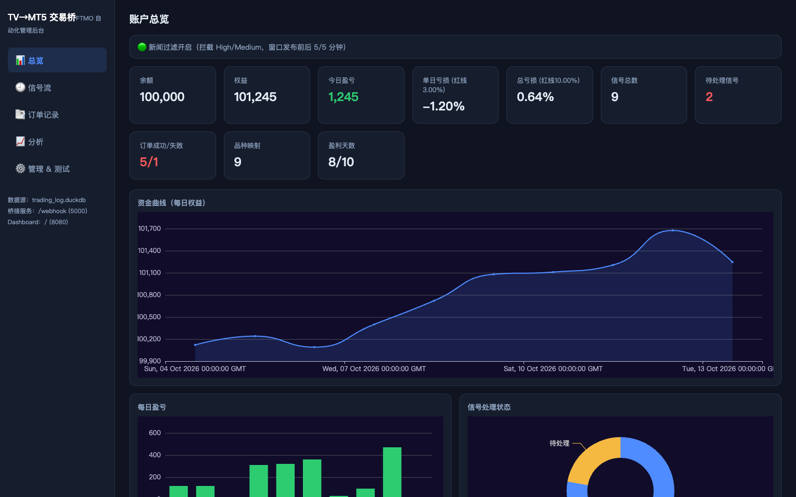
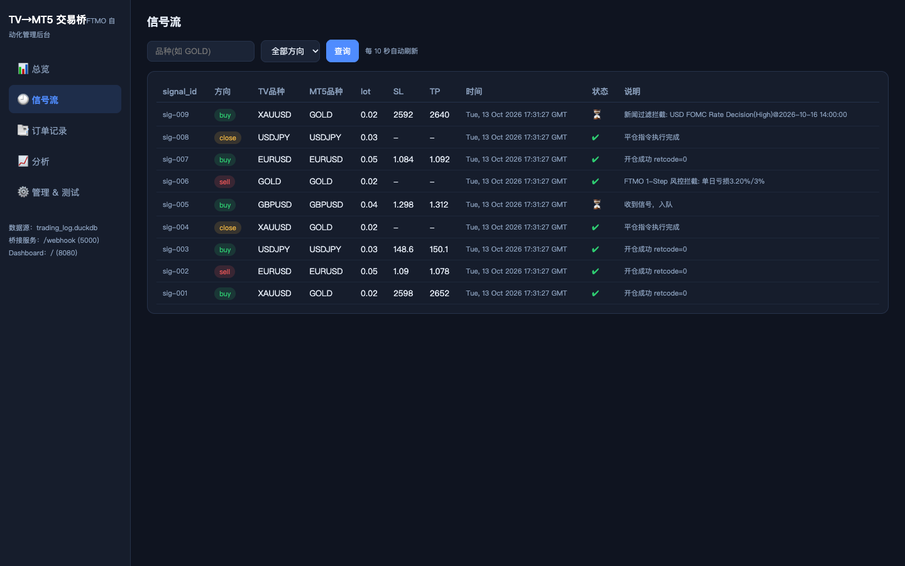
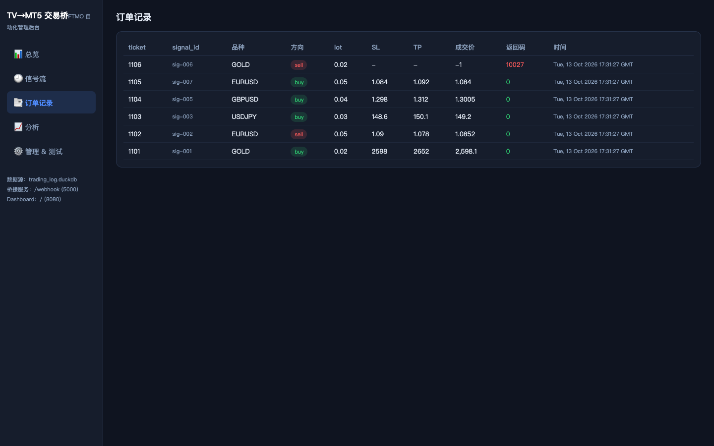
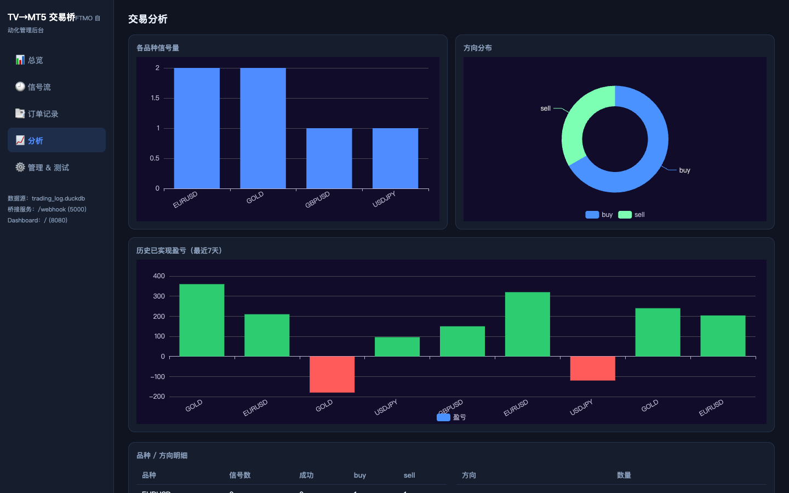
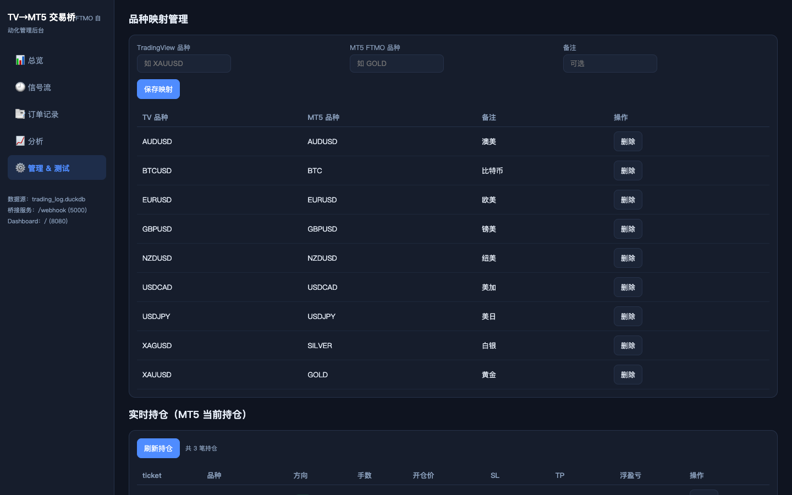

# TradingView → MT5 自动交易桥接服务（FTMO）

TradingView 付费版 Webhook 信号 → Flask → MetaTrader5 → DuckDB 的量化自动下单桥接服务，

附带 **管理后台 Dashboard** 与 **MT5 进程守护脚本**。

## 架构

```
TradingView Alert (付费版, 带Webhook)
        │  POST JSON 信号 (含 signal_id 去重ID)
        ▼
Flask Webhook 服务 (Windows VPS, :5000) ──────────────┐
        │  校验 → 去重 → 入队                            │ HTTP /api/account
        ▼                                              │
单线程 Worker (串行, 规避mt5线程不安全)                  ▼
        │  品种映射(DuckDB) → FTMO风控校验 → 下单      Dashboard 管理后台 (:8080)
        ▼                                               │
MetaTrader5 (登录FTMO, 自动交易按钮开启)                 │ 读 DuckDB
        │                                               │
        ▼  账户快照线程(每5min)                          ▼
DuckDB (trading_log.duckdb) ──────────────────────▶ 资金曲线/信号/订单/分析
```

三个常驻进程 / 任务：

- `TvMt5Bridge` 服务：桥接服务（:5000）
- `TvMt5Dashboard` 服务：管理后台（:8080）
- `TvMt5BridgeGuard` 计划任务：每 1 分钟守护 MT5 与桥接服务，异常自动重启

## 文件说明

| 文件                              | 作用                                          |
| ------------------------------- | ------------------------------------------- |
| `tv_mt5_bridge.py`              | 桥接主程序：Webhook 接收、去重、风控、开 / 平仓、日志、账户快照       |
| `dashboard.py`                  | 管理后台：总览 / 信号 / 订单 / 分析 / 映射管理 / 风控规则 / 测试信号 |
| `templates/dashboard.html`      | 后台前端（原生 JS + 本地 ECharts）                    |
| `static/echarts.min.js`         | ECharts 本地库（已下载，无需外网）                       |
| `guard_mt5.ps1`                 | MT5 + 桥接进程守护脚本，支持 -Loop /-Register          |
| `deploy.ps1`                    | Windows VPS 一键部署（含注册两服务 + 守护任务）             |
| `run.ps1` / `run_dashboard.ps1` | 手动前台调试运行                                    |
| `query_duckdb.py`               | 命令行查询 DuckDB 日志                             |
| `requirements.txt`              | Python 依赖清单                                 |
| `.env.example`                  | 配置模板                                        |

## 环境要求

- **Windows**（MetaTrader5 Python 库仅支持 Windows，Linux/macOS 无法直接运行）
- Python 3.10+（安装时勾选 Add to PATH）
- MT5 客户端已安装并登录 FTMO 账号
- MT5 【自动交易】按钮开启（绿色），工具→选项→EA 交易→允许算法交易
- TradingView 付费版（Essential 及以上才支持 Webhook）

## 部署步骤

> 📖
>
> **完整图文教程见&#x20;**
>
> [DEPLOY.md](DEPLOY.md)
>
> （含架构 / 端口、环境准备、防火墙安全组、浏览器访问 Dashboard、TradingView Alert 配置、常见问题）。

### 1. 把本项目放到 Windows VPS

将 `tv-mt5-bridge` 整个目录拷贝到服务器，例如 `C:\ai-strategy\tv-mt5-bridge`。

### 2. 一键部署

右键 PowerShell → 以管理员身份运行：

```
cd C:\ai-strategy\tv-mt5-bridge
.\deploy.ps1
```

脚本会自动：装依赖 → 生成 .env → 语法检查 → 确认 MT5 → 注册开机自启服务 `TvMt5Bridge`。

### 3. 配置 .env

```
MT5_LOGIN=你的FTMO账号数字
MT5_PASS=你的MT5密码
MT5_SERVER=FTMO-MT5
FLASK_PORT=5000
```

### 4. 防火墙放行端口

```
New-NetFirewallRule -DisplayName "TV-Webhook" -Direction Inbound -LocalPort 5000 -Protocol TCP -Action Allow
```

### 5. TradingView 配置 Alert

- Webhook URL：`http://<服务器公网IP>:5000/webhook`
- **必带 TOKEN**：`.env` 中配置的 `WEBHOOK_TOKEN`，放在 JSON body 的 `token` 字段（也支持请求头 `X-Webhook-Token`）。缺失或错误会被返回 `401` 拒绝执行。
- JSON 消息（开仓）：

```
{
  "signal_id": "{{tostring(time)}}",
  "action": "{{strategy.order.action}}",
  "symbol": "{{symbol}}",
  "token": "你在.env里设置的WEBHOOK_TOKEN",
  "lot": 0.02,
  "sl": {{strategy.order.sl}},
  "tp": {{strategy.order.tp}}
}
```

- JSON 消息（平仓全部）：

```
{
  "signal_id": "{{tostring(time)}}",
  "action": "close",
  "symbol": "{{symbol}}",
  "token": "你在.env里设置的WEBHOOK_TOKEN",
  "lot": 0,
  "sl": 0,
  "tp": 0
}
```

> ⚠️ TV 品种名需在 DuckDB
>
> `symbol_mapping`
>
> 表中映射到 MT5 品种（如
>
> `XAUUSD→GOLD`
>
> ）。已预置常见映射，新增在后台 "管理" 页或 query_duckdb.py 添加。

## Dashboard 管理后台

浏览器访问 `http://<服务器公网IP>:8080`，功能：

| 页签      | 功能                                                      |
| ------- | ------------------------------------------------------- |
| 总览      | 余额 / 权益 / 今日盈亏 / 信号 / 订单 KPI，资金曲线、每日盈亏、信号处理状态图          |
| 信号流     | 实时信号表（每 10s 刷新），按品种 / 方向筛选                              |
| 订单记录    | MT5 成交明细（ticket、价格、返回码）                                 |
| 分析      | 各品种信号量、方向分布图表；**历史已实现盈亏**（最近 7 天平仓单明细 + 累计）             |
| 管理 & 测试 | 风控规则实时状态；品种映射增删查；**实时持仓列表 + 按 ticket 精确平仓**；发送测试信号验证全链路 |

> 说明：  
> Dashboard 只读 DuckDB；实时账户 / 持仓 / 历史盈亏通过 HTTP 调用桥接服务
>
> `/api/*`
>
> ，不在本进程内直接连接 MT5。  
> 桥接服务新增接口：
>
> `/api/account`
>
> (实时账户)、
>
> `/api/positions`
>
> (当前持仓)、
>
> `/api/close-ticket`
>
> (按 ticket 平仓)、
>
> `/api/history`
>
> (历史成交盈亏)。  
> 「按 ticket 平仓」「测试信号」会
>
> **真实向 FTMO 下单**
>
> ，页面均有二次确认。

### 界面预览（演示数据渲染）

> 以下为用演示数据渲染的界面效果，真实部署后数据即替换为你的账户实况。

**总览页**：账户 KPI、FTMO 1-Step 双红线占用率、资金曲线、每日盈亏、信号处理状态



**信号流页**：实时信号表（含风控 / 新闻拦截记录、状态标记），按品种 / 方向筛选



**订单记录页**：MT5 成交明细（ticket / 价格 / 返回码）



**分析页**：各品种信号量、方向分布、历史已实现盈亏



**管理 & 测试页**：品种映射管理、实时持仓（按 ticket 精确平仓）、测试信号



## 进程守护

`guard_mt5.ps1` 自动检测 MT5 客户端与桥接服务，异常重启：

- 手动单次检查：`powershell -ExecutionPolicy Bypass -File guard_mt5.ps1`
- 常驻循环（30s）：`... -Loop`
- 注册开机自启计划任务（每 1 分钟）：`... -Register`（deploy.ps1 已自动执行）
- 日志写入 `guard.log`
- ⚠️ 部署后请检查脚本顶部 `$MT5_EXE` 是否指向你实际的 MT5 安装路径

## 查看日志

```
cd C:\ai-strategy\tv-mt5-bridge
.\venv\Scripts\python.exe query_duckdb.py
```

## 风控说明（FTMO 1-Step 双红线）

桥接服务内置 **FTMO 1-Step Challenge** 官方风控，在下单前用当前**权益 (equity)** 校验两条红线，任一触发即拦截开单：

| 规则           | 官方参数                        | 计算口径                              | 重置             |
| ------------ | --------------------------- | --------------------------------- | -------------- |
| **MDL 单日亏损** | 初始余额的 **3%**                | (初始余额 − 当前权益) / 初始余额 ≥ 3% 拦截      | 每日服务器日界重置      |
| **ML 总亏损**   | 初始余额的 **10%**（EOD Trailing） | (历史最高日终余额 − 当前权益) / 初始余额 ≥ 10% 拦截 | 每日收盘后按最高日终余额更新 |

- **初始余额**：首次运行自动从 MT5 记录，也可在 `.env` 用 `FTMO_INITIAL_BALANCE` 显式指定
- **EOD Trailing 锚点（历史最高日终余额）**：由快照线程从每日账户余额中维护，遵循官方 "仅按日终最高余额上移、不回撤" 的机制
- 参数可在 `.env` 覆盖：`FTMO_DAILY_LOSS_PCT`、`FTMO_TOTAL_LOSS_PCT`
- Dashboard 总览实时显示两条红线的当前占用率
- 该拦截是 **Python 层兜底**，**不能替代 FTMO 服务端风控**，极端滑点仍可能击穿
- 强烈建议先用 FTMO 模拟盘 / Demo 账户验证信号链路

> 注：1-Step 挑战阶段官方允许新闻交易，但本项目仍提供
>
> **可选新闻过滤**
>
> （见下），是否开启由用户决定。盈利端另有「最佳日规则 (单日盈利≤盈利日总和 50%)」，本桥接只做亏损端拦截。

## 新闻过滤

桥接服务内置新闻过滤，基于 **Forex Factory 公开经济日历 JSON**，在高影响事件发布前后 N 分钟内**禁止开仓**（平仓不受限）：

| 配置项                         | 默认                 | 说明                         |
| --------------------------- | ------------------ | -------------------------- |
| `NEWS_FILTER_ENABLED`       | `true`             | 总开关                        |
| `NEWS_IMPACT`               | `High,Medium`      | 拦截的影响等级                    |
| `NEWS_MINUTES_BEFORE/AFTER` | `5/5`              | 发布前 / 后窗口（分钟）              |
| `NEWS_COUNTRIES`            | 空                  | 拦截的币种；留空 = 全部，或按品种自动匹配相关币种 |
| `NEWS_API_URL`              | Forex Factory JSON | 日历数据源（可换兼容端点）              |
| `NEWS_REFRESH_SEC`          | `1800`             | 日历刷新周期                     |

- 品种自动匹配：如 `GOLD/XAUUSD→USD`、`EURUSD→EUR+USD`，只拦截与该品种相关币种的高影响新闻
- 拉取失败会降级放行（只记日志，不拦截交易），避免外网异常时漏单
- Dashboard 总览实时显示新闻过滤状态（绿色 = 开启、红色 = 当前在窗口内）
- `/api/news` 返回当前窗口状态与最近 50 条经济日历

## 交易时段 / 单日开仓次数（风控增强）

桥接服务内置两类附加风控，**只约束开仓（buy/sell），平仓（close）始终放行**（用于紧急离场）：

| 配置项                  | 默认            | 说明                                                         |
| -------------------- | ------------- | ---------------------------------------------------------- |
| `TRADING_ENABLED`    | `true`        | 交易总开关（false 时禁止一切开仓）                                       |
| `TRADING_OPEN_DAYS`  | `1,2,3,4,5`   | 允许开仓的星期（1 = 周一..7 = 周日，逗号分隔；默认周一～周五，周末不开）                  |
| `TRADING_OPEN_HOURS` | `00:00-23:59` | 允许开仓的 **UTC** 时间窗口（`HH:MM-HH:MM`）。如只做欧盘 + 美盘：`13:00-21:00` |
| `TRADING_HOLIDAYS`   | 空             | 节假日（UTC 日期 `YYYY-MM-DD`，逗号分隔），当日禁止开仓                       |
| `MAX_OPEN_PER_DAY`   | `0`           | 单日最大成功开仓次数（`0`= 不限），按 **UTC 日** 自动重置                       |

- 时段判定基于 **UTC**（服务器本地时间若不同，请注意换算；中国 VPS 为 UTC+8，`00:00-23:59` 对应北京 `08:00` 至次日 `07:59`）
- 开仓次数在**成功下单后**累计；跨 UTC 日自动清零，写入 DuckDB `runtime_config`（`open_count_date`/`open_count`）
- 触发时在信号表记录原因（如 `交易时段拦截: 今日星期6 不在允许开仓日...`、`单日开仓次数限制: 今日已达 5 笔`）
- Dashboard「管理 & 测试」页顶部实时展示全部风控规则当前状态与是否可开仓

## 风险提示（FTMO 红线）

1. 品种代码映射必须准确，否则下单失败
2. 网络抖动会重复推送 Alert，务必用 `signal_id` 去重（代码已内置）
3. 禁止高频、剥头皮；遵守 FTMO 1-Step 红线：单日亏损 3%、总亏损 10%（相对初始余额）
4. MT5 进程卡死需额外监控（服务 + 重启脚本），本脚本只负责进程级自启
